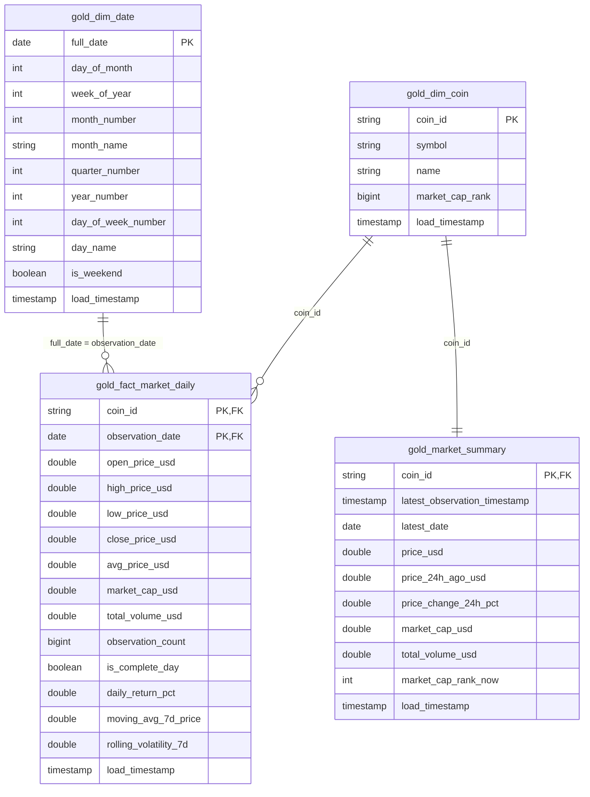

# crypto-market-analytics
Cryptocurrency Market Analytics Pipeline using Apache Spark, Databricks and Power BI


## Bronze and Silver Data Pipeline

### Project Overview

This project uses Apache Spark (PySpark) and Delta Lake in Databricks to ingest, validate, and prepare cryptocurrency market data for downstream analytics and Power BI reporting.

The data pipeline follows a layered architecture:

**JSON Source Files → Bronze Layer → Silver Layer → Analytics / Power BI**

### Bronze Layer

**Notebook:** `01_bronze_pipeline_final`  
**Runner notebook:** `00_run_bronze`  
**Delta table:** `workspace.default.bronze_coin_market_raw`

The Bronze layer:

- Reads cryptocurrency market data from JSON files using an explicit schema.
- Extracts price, market capitalization, and trading volume observations.
- Preserves source-file information and load timestamps.
- Validates source structure and observation alignment.
- Quarantines malformed or invalid data.
- Uses Delta MERGE to prevent duplicate business keys during reprocessing.

**Business key:** `coin_id`, `observation_timestamp`

### Silver Layer

**Notebook:** `02_silver_pipeline_final`  
**Runner notebook:** `00_run_silver`  
**Delta table:** `workspace.default.silver_market_observation`

The Silver layer:

- Reads observations from the Bronze Delta table.
- Rejects missing cryptocurrency IDs or observation timestamps.
- Rejects null, NaN, or negative market values.
- Stores rejected observations with rejection reasons.
- Uses Delta MERGE to insert new observations and update existing ones.
- Records pipeline execution results.

**Business key:** `coin_id`, `observation_timestamp`

### Data Models

**Bronze columns**

| Column | Data Type |
|---|---|
| coin_id | STRING |
| source_file | STRING |
| timestamp_ms | BIGINT |
| price_usd | DOUBLE |
| market_cap_usd | DOUBLE |
| total_volume_usd | DOUBLE |
| load_timestamp | TIMESTAMP |
| observation_timestamp | TIMESTAMP |

**Silver columns**

| Column | Data Type |
|---|---|
| coin_id | STRING |
| observation_timestamp | TIMESTAMP |
| price_usd | DOUBLE |
| market_cap_usd | DOUBLE |
| total_volume_usd | DOUBLE |
| source_file | STRING |
| load_timestamp | TIMESTAMP |

Both layers use the composite business key `(coin_id, observation_timestamp)`. The `load_timestamp` in Silver is carried forward from Bronze.

### Running the Pipelines

Run the notebooks in the following order:

1. `00_run_bronze`
2. `00_run_silver`

Each runner executes its corresponding final pipeline notebook.

The pipelines support these parameters:

| Parameter | Description |
|---|---|
| `load_type` | `full_load` or `incremental_load` |
| `processing_date` | Optional date in `YYYY-MM-DD` format |
| `source_folder` | Optional source-folder selection |

For Silver, an empty date and folder selection processes all available Bronze observations. A supplied `processing_date` filters by observation date, while `source_folder` filters the Bronze source-file path. The Silver `load_type` parameter is recorded for execution tracking; it does not independently change filtering behavior.

### Data Quality and Quarantine

Invalid data is retained for investigation rather than silently discarded.

Relevant tables include:

- `workspace.default.bronze_file_quarantine`
- `workspace.default.silver_quarantine`

Quarantine records provide information about rejected data and the reason for rejection.

### Execution Logging

Pipeline executions are recorded in:

`workspace.default.pipeline_execution_logs`

The log stores:

- Run ID and pipeline layer
- Target table
- Load type, processing date, and source folder
- Execution start and end timestamps
- SUCCESS or FAILED status
- Rows read, inserted, updated, and quarantined
- Error messages for logged failures

### Validation Results

The tested dataset produced:

| Metric | Result |
|---|---:|
| Bronze observations | 534509|
| Silver observations | 544885|
| Quarantined Silver observations | 0 |
| Unique cryptocurrencies | 250 |
| Duplicate Silver business keys | 0 |

Reprocessing the same Silver observations did not increase the Silver record count, confirming repeat-safe loading for the tested dataset.

### Technologies

- Python
- Apache Spark / PySpark
- Databricks
- Delta Lake
- GitHub
- Power BI (downstream analytics and visualization)

# Phase 3 README sections (paste into README.md)

## Pipeline flow
CoinGecko API -> scripts -> raw JSON -> **Bronze** (`bronze_coin_market_raw`) -> **Silver** (`silver_market_observation`) -> **Gold** (star schema) -> Power BI.
`notebooks/00_run_all` runs Bronze, Silver and Gold in order; each stage starts only if the previous one succeeded, and every stage writes to `pipeline_execution_logs`.

## Gold star schema



### Gold data dictionary
| Table | Role | Grain / primary key | Source |
|---|---|---|---|
| `gold_fact_market_daily` | Fact | one row per coin per day: (`coin_id`, `observation_date`) | Silver, hourly rows aggregated to daily |
| `gold_dim_coin` | Dimension | `coin_id` | `coin_manifest.json` from the full load (symbol, name, rank at full-load time); any Silver coin missing from the manifest is added |
| `gold_dim_date` | Dimension | `full_date` | generated calendar covering the fact table's date range |
| `gold_market_summary` | Summary (KPI) | `coin_id` | latest Silver observation per coin vs about 24 hours earlier |

Fact measures: `open/high/low/close/avg_price_usd` (first / max / min / last / mean hourly price of the day), `market_cap_usd` and `total_volume_usd` (last observation of the day; CoinGecko volume is a rolling 24h figure, so it is not summed), `observation_count` (hours observed), `is_complete_day` (24+ hours), `daily_return_pct` (close vs previous close), `moving_avg_7d_price` (average close of the last 7 daily rows), `rolling_volatility_7d` (sample standard deviation of the last 7 daily returns).

### Refresh strategy
- `full`: rebuild every day from all of Silver.
- `incremental`: recompute days from `processing_date - 1` onward, reading a 14-day lookback from Silver so moving windows and day-over-day returns are correct. If Gold is empty, the run switches to full by itself.
- All four tables use MERGE and update a row only when a value changed, so re-running gives 0 inserted / 0 updated.

### Read optimisation
`gold_fact_market_daily` is created with liquid clustering on (`coin_id`, `observation_date`), the columns Power BI filters and joins on; `OPTIMIZE` runs at the end of every Gold run. Primary and foreign keys are declared as informational constraints (setup notebook).

## Execution guide
| Goal | Notebook | `load_type` | `processing_date` | `source_folder` |
|---|---|---|---|---|
| First ever load | `00_setup_tables`, then `00_run_all` | `full` | blank | blank |
| Daily load | `00_run_all` | `incremental` | folder date | blank |
| Backfill one past day | `00_run_all` | `incremental` | that date | blank |
| Rebuild Gold only | `03_gold_aggregation/00_run_gold` | `full` | blank | n/a |

## Power BI setup
1. Databricks: **SQL Warehouses** -> your warehouse -> **Connection details**. Copy the Server hostname and HTTP path. Create a personal access token (profile -> Settings -> Developer -> Access tokens), if your account offers it.
2. Power BI Desktop: **Get data** -> **Databricks** -> paste hostname and HTTP path -> **Import** -> sign in with the token.
3. Choose catalog `workspace`, schema `default`, and import:
   `gold_fact_market_daily`, `gold_dim_coin`, `gold_dim_date`, `gold_market_summary`, `pipeline_execution_logs`, `bronze_quarantine`, `bronze_file_quarantine`, `silver_quarantine`.
4. **Model view** relationships (all one-to-many, single direction from dimension to fact):
   - `gold_dim_coin[coin_id]` -> `gold_fact_market_daily[coin_id]`
   - `gold_dim_date[full_date]` -> `gold_fact_market_daily[observation_date]`
   - `gold_dim_coin[coin_id]` -> `gold_market_summary[coin_id]`
   Mark `gold_dim_date` as the date table (Table tools -> Mark as date table -> `full_date`).
5. Visuals (use the coin slicer from `gold_dim_coin[name]`; default it to `market_cap_rank <= 10` because 250 coins make a line chart unreadable):
   - KPI cards: sum of `gold_market_summary[market_cap_usd]`; best and worst 24h performer (Top N on `price_change_24h_pct`); distinct count of `gold_dim_date[full_date]` for days of history.
   - Line chart: `full_date` x `close_price_usd` by coin (price trend).
   - Clustered bar: coin name x `gold_market_summary[market_cap_usd]` (market-cap comparison).
   - Line chart: `full_date` x `rolling_volatility_7d` (volatility); optional second axis `total_volume_usd`.
   - Audit page: rows inserted/updated by `layer` over `end_timestamp`; run `status` counts; quarantine rows by `rejection_reason`; run duration (`end_timestamp - start_timestamp`) by layer.
   - Filter out partial days with `is_complete_day = true` when comparing days.

## Report checklist
- **Architecture diagram:** API -> scripts -> Bronze -> Silver -> Gold -> Power BI, with the logging and quarantine tables beside each layer.
- **Decision log (use your real test results):**
  - Partitioning: tables are small (hundreds of thousands of rows), so no partition columns; partitioning would only create tiny files. The fact table is liquid-clustered on (`coin_id`, `observation_date`) instead.
  - Schema drift: Bronze quarantines files whose values stop being numbers (`bronze_file_quarantine`) and reports new unexpected fields in the log; Silver converts with `try_cast` and quarantines non-conforming rows. Cite your drift test.
  - PII: none (market-level data, see Phase 1 section 5); the only secret is the API key, kept out of Git via `.env`.
- **Spark DAG analysis:** the Gold fact aggregation is the most complex step. Run `03_gold_pipeline_final` and read step 9 (`explain("formatted")`): a `groupBy` produces an `Exchange hashpartitioning(coin_id, observation_date)` (shuffle), the window functions add a second exchange partitioned by `coin_id`, and filters on the Silver scan show as pushed filters (predicate pushdown). Screenshot the query profile (Databricks serverless: Query history -> the query -> Query profile; the classic Spark UI may not be available on serverless) and explain the stages.
- **FinOps:** get real timings with:
```sql
SELECT layer, load_type, count(*) AS runs,
       round(avg(unix_timestamp(end_timestamp) - unix_timestamp(start_timestamp)), 1) AS avg_seconds
FROM workspace.default.pipeline_execution_logs
WHERE status = 'SUCCESS'
GROUP BY layer, load_type ORDER BY layer, load_type;
```
  Hourly-for-a-year estimate = (run minutes / 60) x 24 x 365 x DBU per hour x price per DBU, using the pricing for your cloud. Optimisation ideas: incremental Gold (already done), schedule on a job cluster / serverless job instead of an interactive notebook, `OPTIMIZE` on a weekly schedule rather than every run, and fetch only changed coins.

